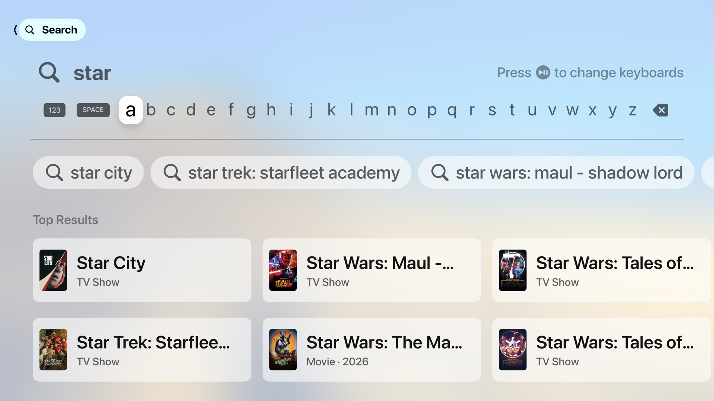
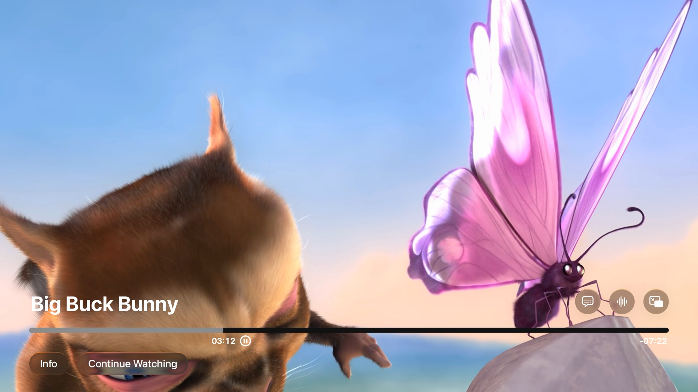

# HomeTV

A native Apple TV app in SwiftUI with an Apple TV app–style interface. It browses and plays from Stremio add-ons,
plays in its own player (KSPlayer, with AVPlayer for Dolby Vision and Atmos), adds TMDB metadata, and syncs with Trakt.
Infuse and VLC remain optional.


| Title detail | Search | Player |
| --- | --- | --- |
|  |  |  |

## Documentation

Everything lives on the docs site, **[hometv.nziranziza.dev](https://hometv.nziranziza.dev/)**:

- [Install HomeTV](https://hometv.nziranziza.dev/guide/install/) on your Apple TV
- [User guide](https://hometv.nziranziza.dev/guide/setup-and-addons/), starting with setup and add-ons
- [Build from source](https://hometv.nziranziza.dev/developers/build-from-source/), for development

## Quick start

Needs Xcode 26.3 with the tvOS platform and [XcodeGen](https://github.com/yonaskolb/XcodeGen).

```sh
cp Secrets.example.xcconfig Secrets.xcconfig   # optional keys, fine to leave blank
scripts/fetch-player-frameworks.sh             # device builds only
xcodegen generate
open HomeTV.xcodeproj
```

Pick the **HomeTV** scheme and an Apple TV 4K simulator, then press ⌘R.

## License

Copyright (C) 2026 the HomeTV contributors.

This program is free software: you can redistribute it and/or modify it under the terms of the GNU General Public
License as published by the Free Software Foundation, either version 3 of the License, or (at your option) any later
version. It is distributed WITHOUT ANY WARRANTY; without even the implied warranty of MERCHANTABILITY or FITNESS FOR A
PARTICULAR PURPOSE. See [LICENSE](LICENSE) for the full text.

SPDX-License-Identifier: GPL-3.0-or-later

Device builds bundle KSPlayer and FFmpegKit, which are GPL-3.0.
See [Licenses](https://hometv.nziranziza.dev/developers/licenses/) for the third-party components and services.
