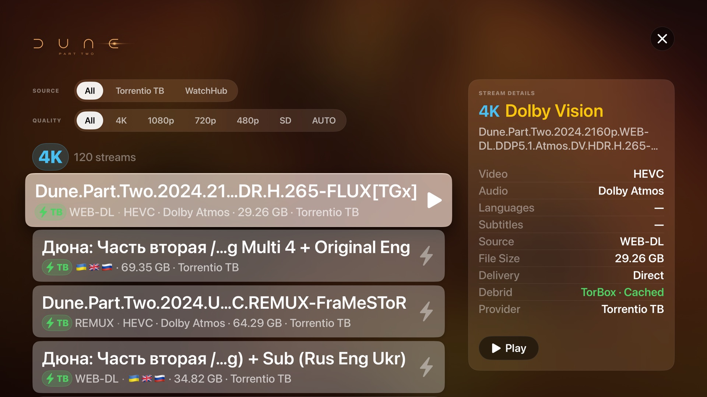
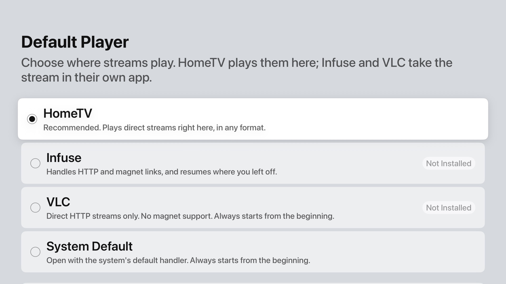
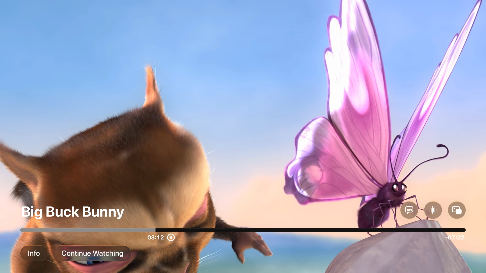

Selecting **Play** on a movie or an episode opens the stream list. A Continue Watching card opens it too, when it
can't play the stream you last used. The list gathers every stream your add-ons offer for that title. Pick one and it plays in your default player: HomeTV's own player, or
Infuse, VLC or another app.

## The stream list

HomeTV asks every add-on you've turned on at the same time, and shows the list once they've all answered. An add-on
that fails is left out without an error.

Focus starts on the first stream. Move down the list to browse, and the **Stream Details** panel on the right
changes to match the stream you're on. Select a stream, or move right to **Play**, to play it. Select the **×** at
the top right, or press Back, to close the list.

### Filters

- **Source** shows one add-on's streams, or **All** of them.
- **Quality** shows one resolution: **4K**, **1080p**, **720p**, **480p**, **SD** or **AUTO**. AUTO is for
  streams whose label doesn't give a resolution. The Quality filter only appears when there's more than one to
  choose from.

The list is grouped by quality, best first, with the number of streams in each group.

### Reading a stream

Everything HomeTV shows about a stream comes from the label its add-on gave it, usually the release name. When the
label doesn't say, the detail shows **—**.

Each row shows the release name, then a line with:

- **A debrid badge**, when the stream comes through a debrid service. See [Debrid streams](#debrid-streams).
- **The source**: REMUX, BluRay, WEB-DL or WEB. **CAM** is shown in red: it was filmed in a cinema.
- **The video codec**, such as HEVC.
- **The audio**, such as Dolby Atmos, Dolby TrueHD, DTS-HD or Dolby Digital+.
- **The audio languages**, as flags. More than four collapse to **+2** and so on.
- **The file size.**
- **The add-on's name**, when Source is set to All.

The icon at the end of the row shows how the stream is delivered: a lightning bolt for a cached debrid stream, a
down arrow for one that has to be downloaded first or for a torrent, and a globe for a direct link. It turns into a
play icon when you focus the row.

The Stream Details panel spells out the same things in full: the resolution and **Dolby Vision** or **HDR**, the
whole release name, then **Video**, **Audio**, **Languages**, **Subtitles**, **Source**, **File Size**,
**Delivery**, **Debrid** and **Provider**. **Delivery** is **Torrent** when the add-on sent the torrent's hash, and
**Direct** otherwise. A Torrent stream that also has a direct link, as some debrid streams do, plays like any other
direct link. The **Subtitles** row only appears when at least one stream lists its subtitle languages.

When your default player isn't HomeTV, the panel says **Opens in Infuse** (or VLC) under Play.

### Debrid streams

Add-ons such as Torrentio can fetch streams through a debrid service like Real-Debrid, AllDebrid, Premiumize or
TorBox. The badge shows the service's short name:

- **Green, with a lightning bolt**: cached. The service already has the file, so it plays straight away.
- **Orange, with a down arrow**: download. The service has to fetch the file first. Until it has, the link plays a
  short "being downloaded" clip instead of the title, or nothing at all.

Pick a cached stream whenever there is one.

### Starting faster

With HomeTV as your player, resting on a stream for a moment starts opening it in the background. By the time you
press Select, it's often ready to play.

### When there are no streams

| Message | What it means |
| --- | --- |
| **No Add-ons Installed** | Every add-on is removed or turned off. [Install a stream add-on](/guide/setup-and-addons/). |
| **No Streaming Add-ons** | Your add-ons only provide catalogs and details, like Cinemeta. Install one that provides streams, such as Torrentio. |
| **No Streams Found** | Your stream add-ons have nothing for this title yet. Select **Try Again** later. |
| **Can't Reach Add-ons** | None of your add-ons answered. Check your connection and select **Try Again**. |
| **No streams at this quality** | The Quality filter is hiding everything. Choose **All**. |

## Which player to choose

Choose the player in **Settings → Default Player**. It applies to everything you play.

| | HomeTV | Infuse | VLC | System Default |
| --- | --- | --- | --- | --- |
| Direct links (http/https) | Yes | Yes | Yes | Depends on the app |
| Magnet links | No | Yes | No | Depends on the app |
| Dolby Vision in MKV | No | Yes | No | Depends on the app |
| Atmos in MKV | No | Dolby Digital+ tracks only | No | Depends on the app |
| Resumes where you stopped | Yes | Yes | No | No |
| Saves where you stopped | Yes | Yes, when you close it | No | No |
| Plays the next episode | Yes, with Up Next | Yes, the season is queued | No | No |

In short:

- **HomeTV** is the default and the one to use for most streams, and for any cached debrid stream.
- **Infuse** for magnet links, and for 4K MKV files where you want Dolby Vision, or Atmos from a Dolby Digital+
  track. A TrueHD Atmos track plays as surround sound without Atmos. It needs the Infuse app.
- **VLC** only plays direct links and always starts from the beginning.
- **System Default** hands the link to whichever app the Apple TV opens it with.

Infuse and VLC show **Not Installed**, and can't be chosen, until their app is on the Apple TV.

You don't have to switch players for one stream: magnet links only appear with add-ons that aren't set up with a
debrid service. If you select one with HomeTV as your player, the list says **This stream can't play in HomeTV.
Choose a direct stream, or switch players in Settings.**

### Infuse

HomeTV opens Infuse with the stream, at your resume point, under a file name Infuse can match to the title, such as
`Severance S02E03.mkv`. The stream list closes.

For an episode, HomeTV hands Infuse the rest of the season as a queue, so the next episodes play one after another
in Infuse. The queue:

- Starts at the episode you picked and carries on into the next season.
- Then plays the episodes before the one you picked, in order. Starting at episode 3 of a five-episode release
  queues 3, 4, 5, 1, 2.
- Holds only episodes from the same release as the stream you picked, from the same add-on. It stops looking, in
  each direction, at the first episode that release doesn't have.
- Leaves out magnet links and debrid streams that aren't cached yet.
- Takes up to 100 episodes. While you browse the list, HomeTV looks up the episodes ahead; after you press Play it
  waits up to five seconds for them.

Infuse gets only the episode you picked when its stream can't start a queue: a magnet link, a debrid stream that
isn't cached, or a stream with nothing to tell its release apart. Infuse also gets one episode when no other
episode has that release.

When you close Infuse and come back, HomeTV reads where you stopped. Episodes the queue got past are marked watched,
and the one you stopped on gets a resume point.

### VLC and System Default

These get the one stream you picked, from the beginning. HomeTV doesn't learn where you stopped, so nothing is
saved and the next Play starts from the beginning again.

## Resume

### Saved position

HomeTV's player saves where you are every ten seconds, whenever you pause, and when you close it. Infuse reports
where you stopped when you close it. That position is what **Resume** on a title's page and Continue Watching start
from.

- Anything under 1% in isn't saved as a resume point.
- Past 95%, the title counts as finished: an episode is marked watched and Play moves on to the next one.

Signed in to [Trakt](/guide/trakt-and-library/), progress from other apps counts too. Whichever was played most
recently wins: HomeTV's own position, or Trakt's.

### Remembered stream

HomeTV remembers the stream you last played for each movie and show. Selecting a card in Continue Watching plays
straight away with that stream, without the stream list:

- For the same episode or movie, it looks for the same file from the same add-on.
- For the next episode of a show, it looks for the same release.
- A debrid stream that isn't cached any more doesn't count.

If the stream can't be found again, or the add-on is turned off, the stream list opens so you can pick another.

## HomeTV's player

### Formats

The player opens most streams your add-ons offer:

- **MP4, MOV and HLS** play through Apple's own video player, with Dolby Vision and Dolby Atmos.
- **MKV, AVI and WebM** play through FFmpeg. They get HDR10 and HDR10+, and multichannel sound from DTS and TrueHD,
  but not Dolby Vision or Atmos. See [Known gaps](#known-gaps).
- If a stream fails to start through Apple's player, HomeTV tries it again through FFmpeg from the same spot.

With **Match Content** turned on in the Apple TV's **Settings → Video and Audio**, the TV switches to the stream's
frame rate and dynamic range, and back when you close the player.

### Controls

Swipe or press Up or Down to show the controls. They hide again after a few seconds of playing.

| Press | What happens |
| --- | --- |
| Select or Play/Pause | Pause or play, and show the controls |
| Left or Right | Go back or forward 10 seconds |
| Hold Left or Right | Rewind or fast-forward. Press again to go faster, Select to play from there |
| Swipe left or right, while paused | Move through the title with a preview, then Select to play from there |
| Up from the progress bar | Move to the Subtitles and Audio buttons |
| Down from the progress bar | Move to the Info and Continue Watching tabs |
| Back | Close a menu, cancel a rewind or swipe, or hide the controls. With the controls hidden, close the player |

If you started from the stream list, closing the player takes you back to it, so you can try another stream.

### Info and Continue Watching

- **Info** shows the poster, the title's details and badges for **4K**, **Dolby Vision**, **HDR10**, **SDH** and
  **AD** (audio description). **From Beginning** restarts the title, and **Go to Movie** or **Go to Show** closes the
  player on the title's page.
- **Continue Watching** shows your other titles in progress. Select one to switch to it, with the stream it last
  played. This tab only appears when you have something else in progress.

### Subtitles

The **Subtitles** button opens:

- **On** and **Off**.
- **Language**: the subtitles inside the file, then languages found by your subtitle add-ons, such as
  OpenSubtitles, with how many files each has. Pick a language to choose a file.
- **Style**: Apple TV's caption styles. **Manage Styles** pauses the player and opens the Apple TV's own settings to
  edit them.
- **Timing**: press Left or Right to move subtitles a tenth of a second earlier or later, and Select to reset. The
  timing is kept for that file.

Subtitles start off, unless the audio isn't in your Apple TV's language: then they start on, in your language.
Turning them on or off, or picking a language, is remembered for the movie or show. Forced subtitles, for lines in another
language, show even when subtitles are off.

### Audio

The **Audio** button opens:

- **Enhance Dialogue**: **Off**, **Enhance** or **Enhance More**, to make voices clearer.
- **Reduce Loud Sounds**, to even out the volume.
- **Audio Track**: every track in the file, with its language and format.

Enhance Dialogue and Reduce Loud Sounds stay set for everything you play. They say **Not available for this
audio** on HLS streams, and on Dolby Digital and Dolby Digital+ tracks in MP4 files, which go to the TV or receiver
untouched.

A title starts with the track you picked last time for that movie or show, otherwise with its original language,
otherwise with your Apple TV's language.

### Skip Intro and Skip Credits

When an intro, recap or credits start, a **Skip Intro**, **Skip Recap** or **Skip Credits** button appears at the
bottom right. Select it to jump past, or press Back to put it away. The times come from the file's chapters, or
from the TheIntroDB and IntroDB databases.

Turn the buttons off in **Settings → Default Player → Skip Intros & Credits**.

### Up Next

When an episode's credits start, or 30 seconds before the end if HomeTV doesn't know when they start, the video
shrinks into a corner. Behind it is the next episode, with **Next Episode** and a countdown.

- Select **Next Episode** to play it now.
- Select the small video, or press Back, to watch the credits full screen. The next episode still plays when this
  one ends.

The next episode plays from the same release and add-on as this one, and carries on into the next season. If that
release doesn't have it, Up Next doesn't appear and the player closes at the end.

Signed in to [Trakt](/guide/trakt-and-library/), the player tells Trakt what you're watching, and finished titles
are added to your Trakt history.

## Known gaps

The built-in player is still being built ([#107](https://github.com/Nziranziza/home-tv/issues/107)). What doesn't work
yet:

- **Picture in Picture.** The button is there but does nothing
  ([#102](https://github.com/Nziranziza/home-tv/issues/102)).
- **Dolby Vision and Atmos in MKV.** MKV files play in HDR10 without Atmos, and Dolby Vision profile 5 may show wrong
  colours. Use Infuse for these ([#105](https://github.com/Nziranziza/home-tv/issues/105)).
- **Magnet links.** They need Infuse ([#107](https://github.com/Nziranziza/home-tv/issues/107)).
- **Debrid streams that aren't cached** play the service's "being downloaded" clip, and can overwrite your saved
  position with it ([#136](https://github.com/Nziranziza/home-tv/issues/136)).
- **Resume from Trakt** uses the show's usual runtime, so an episode watched in another app can resume a little early
  or late when it's longer or shorter than usual ([#90](https://github.com/Nziranziza/home-tv/issues/90)).
- **Streams that fail in Infuse**, for example with "Server responded with status 429", leave you in Infuse's error
  with no way back to the list ([#49](https://github.com/Nziranziza/home-tv/issues/49)).
