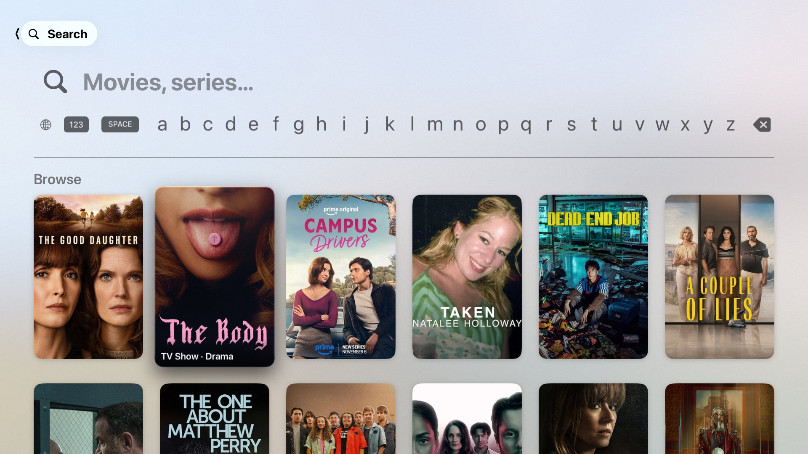
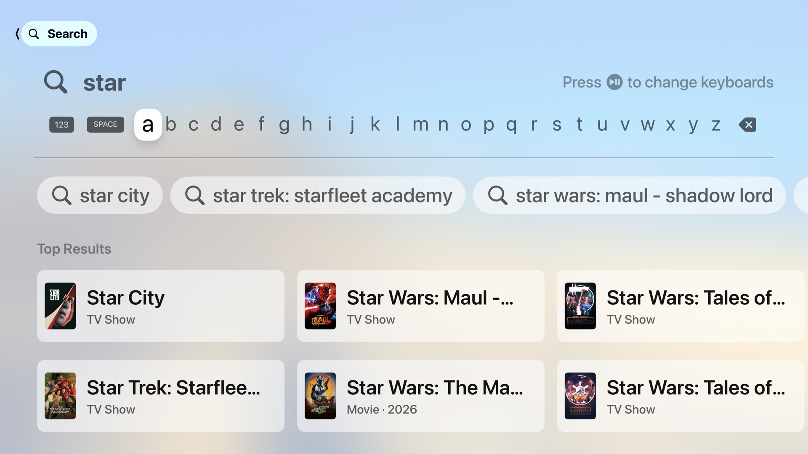
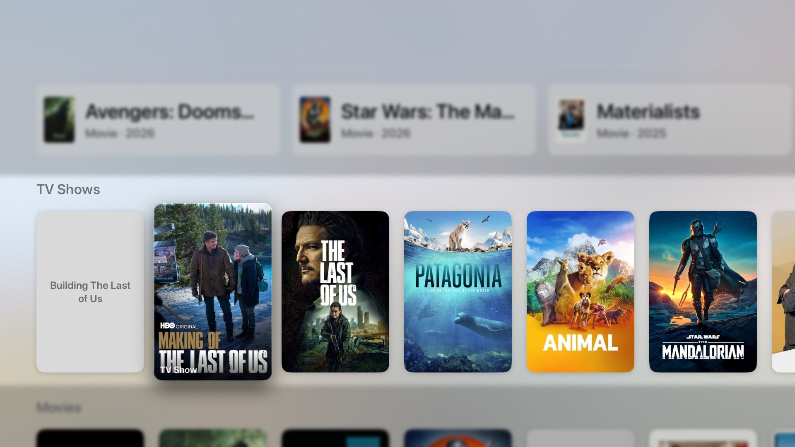
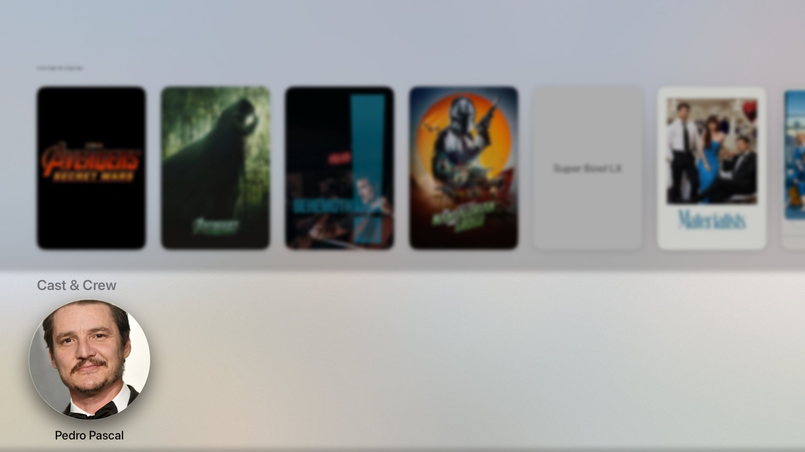
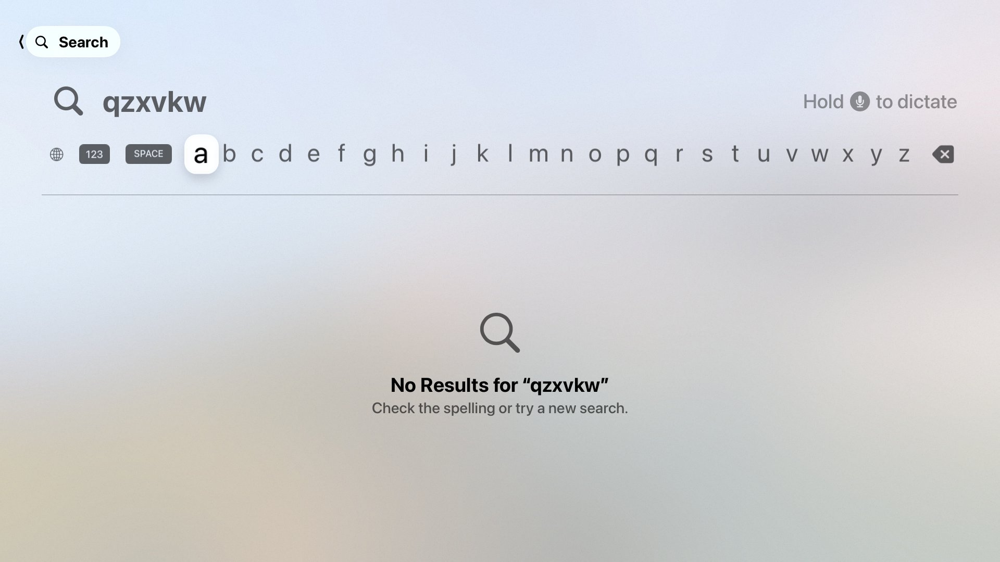

Search looks for movies and shows in every add-on you've installed that supports search, and for actors and crew
on TMDB, all at once. Open **Search** from the sidebar. Press Up from the keyboard to get back to the sidebar.

## Browse

Before you type, Search shows **Browse**: a grid of posters from the first few catalogs of your add-ons, such as
Cinemeta's Popular Movies and Popular TV Shows. Focus a poster to see whether it's a movie or a show, and select it
to open its [page](/guide/titles-episodes-cast/).

## Typing

The search field and keyboard are the Apple TV's own, so you can type in any of the usual ways:

- **With the remote.** Move along the letters and press Select on each one. Press play/pause to switch keyboard
  layouts.
- **With your voice.** On a remote with a microphone button, hold it and say what you're looking for.
- **With your iPhone.** While the keyboard is on screen, an iPhone signed in to the same Apple Account shows an
  **Apple TV Keyboard** notification. Tap it to type on the iPhone. See
  [Typing URLs with your iPhone](/guide/setup-and-addons/#typing-urls-with-your-iphone) for the details.

Results appear once you've typed two characters and paused for a moment. They update as you keep typing. Delete back
to one character, or none, and Browse comes back.

## Results

Results come in sections, from top to bottom. A section only appears when it has something in it.

1. **Suggestions**: up to eight chips under the keyboard, such as **star city** or **star trek: starfleet
   academy**. They're titles and names from the results that match what you've typed. Select one to search for it.
2. **Top Results**: the twelve best matches of any kind, in two rows. Each card spells out the title and says
   whether it's a movie or a TV show, with its genre and, for a movie, its year.
3. **TV Shows**: every show in the results.
4. **Movies**: every movie in the results.
5. **Cast & Crew**: people whose name matches.

Select a title to open its page. Press Back to return to your results.

### TV Shows and Movies

These rows hold all the results of each type, in the same order as Top Results. Results of other types, such as
live TV channels from an add-on that has them, only appear in Top Results.

If two add-ons return the same title, it shows up once.

### Cast & Crew

Up to twenty people from TMDB whose name matches, best known first. Focus a headshot to see the name, and select it
to open the [person's page](/guide/titles-episodes-cast/#person-page) with their movies and shows.

This row needs a [TMDB key](/guide/setup-and-addons/#optional-tmdb-and-trakt-keys). Without one, Search finds
titles only.

## How results are ordered

Your add-ons decide which titles match a search. HomeTV puts what they return in order, with the closest match to
the title first:

1. The title is exactly what you typed: **silo** finds **Silo**.
2. The title starts with what you typed: **si** finds **Silo**.
3. A later word in the title starts with what you typed: **si** finds **Bad Sisters**. Words split at spaces and at
   punctuation, so **man** finds **Spider-Man**.
4. What you typed appears inside a word: **ilo** finds **Silo**.
5. Everything else the add-on returned.

Capitals and accents don't matter. Within each group, titles with a higher IMDb rating come first, then newer ones.

The last group is there because add-ons can match on more than the title. Cinemeta also matches cast, so searching
**pedro pascal** returns his movies and shows even though his name isn't in their titles.

## When a title doesn't show up

### Search says "No Results"

None of your add-ons returned anything, and nobody on TMDB matched. In order:

1. **Check the spelling**, or type less: a single distinctive word often works better than a full title.
2. **Refresh your add-ons.** HomeTV keeps a copy of each add-on's manifest from when you installed it, and that copy
   says which of its catalogs can be searched. When it's out of date, HomeTV can't search the add-on, even though its
   titles still show on Watch Now. [Refresh the add-on](/guide/setup-and-addons/#refresh-an-add-on), starting with Cinemeta.
3. **Check your connection.** An add-on that can't be reached is skipped without an error, so if none can, Search
   finds nothing.

### A title is missing from the results

- **No add-on has it.** Search only finds what your add-ons know about. Try searching for the title's original name,
  or install another catalog add-on.
- **The add-on that has it can't be searched.** Only add-ons whose catalogs support search are searched. An add-on
  that only provides streams or subtitles doesn't add search results, and some catalog add-ons only offer rows to
  browse. Their titles can still appear on Watch Now.
- **The add-on is turned off.** Add-ons switched off in **Settings → Addons** aren't searched. See
  [Turn an add-on off](/guide/setup-and-addons/#turn-an-add-on-off).
- **The add-on's manifest is out of date.** [Refresh it](/guide/setup-and-addons/#refresh-an-add-on).
- **It's further along.** Top Results holds twelve titles. Scroll along the TV Shows or Movies row to see the rest.

### Search says "No Addons"

Every add-on is removed or turned off. Install a catalog add-on, such as Cinemeta, from
**Settings → Addons → Community Addons**, or turn one back on.

### There's no Cast & Crew row

Search needs a [TMDB key](/guide/setup-and-addons/#optional-tmdb-and-trakt-keys) to find people. With a key, the row
only appears when someone's name matches what you typed.

## Remote controls

| Where | Select | Up | Down |
| --- | --- | --- | --- |
| Keyboard | Type the letter | Open the sidebar | Move to the results |
| Suggestion | Search for it | Move to the keyboard | Move to Top Results |
| Top Results | Open the title's page | Move up a row | Move down a row |
| TV Shows or Movies | Open the title's page | Move to the row above | Move to the row below |
| Cast & Crew | Open the person's page | Move to the row above | — |
| Browse | Open the title's page | Move up a row | Move down a row |

Press play/pause on the keyboard to switch keyboards, and hold the microphone button to dictate.
