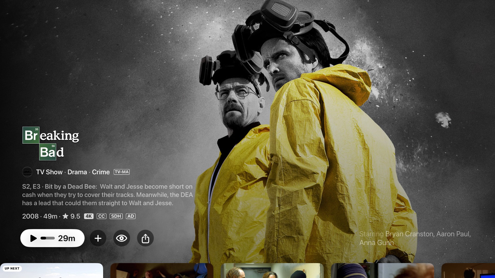
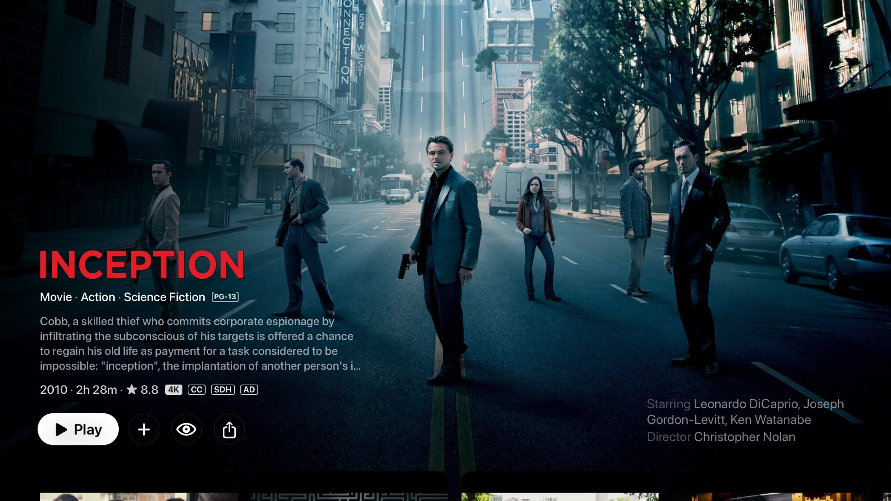
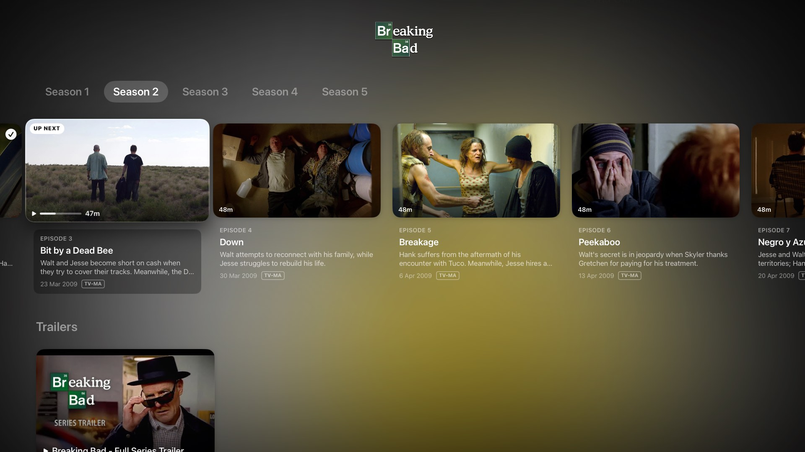
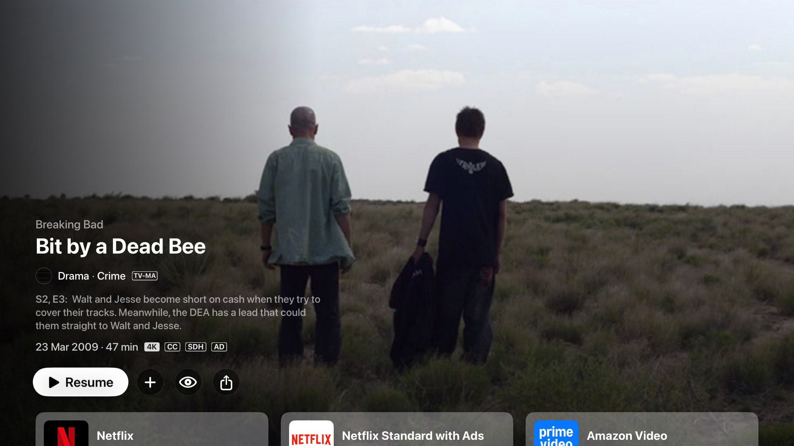
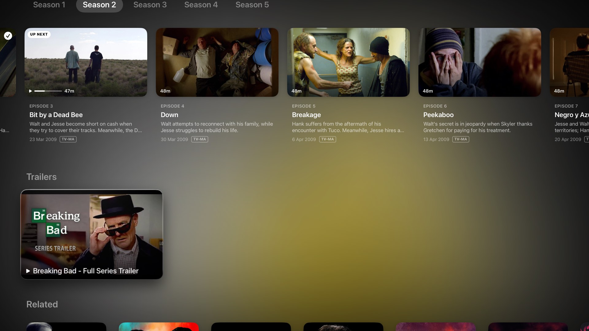
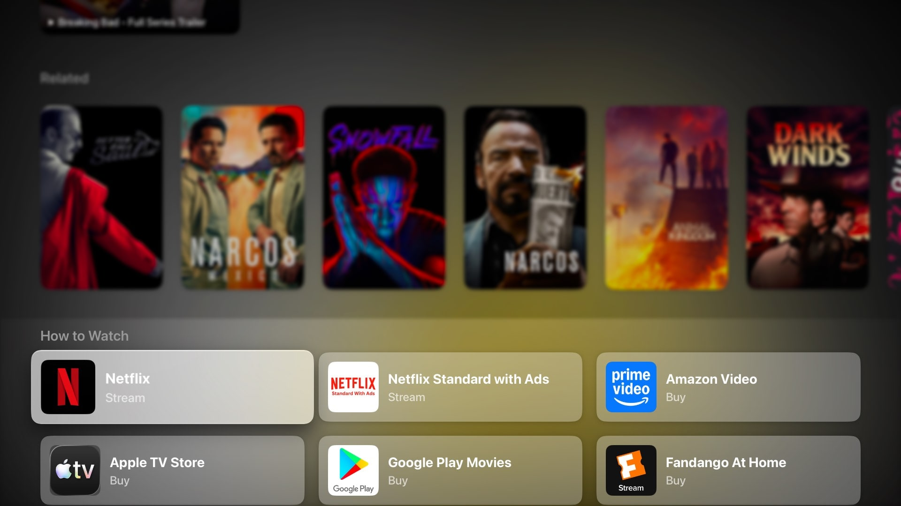
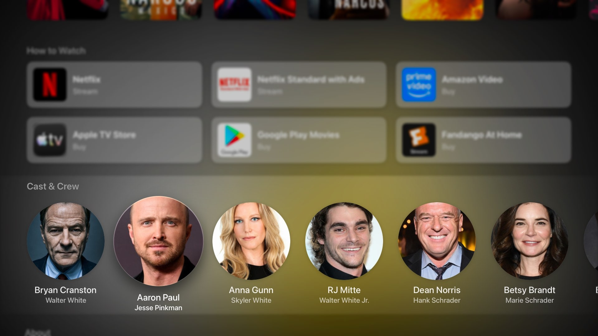
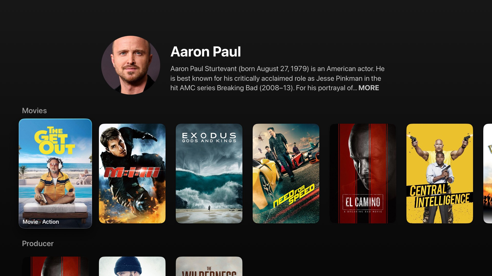

Every movie and show has its own page. You reach it from posters all over HomeTV: Watch Now, Search, the Library
and the Top Shelf. Movies and shows share the same layout. A show adds an episode list and its own page for each episode.

The page opens on a full-screen hero. Press Down to scroll into the rows below it, and press Back (Menu on older
remotes) to leave.

If no add-on can load the title, the page says **Couldn't Load** with the title's name. Check your connection and
select **Try Again**.

## Hero

The hero shows the title's logo or name, its type and genres, its age rating, and the streaming service that
carries it (when you've added a [TMDB key](/guide/setup-and-addons/#optional-tmdb-and-trakt-keys)). Under that come
a description, the year, runtime and IMDb rating, and on the right, who stars in it and who directed it.

The buttons under the description:

- **Play** opens the stream list. [Picking a stream](/guide/playback/) covers the list.
- **+** adds the title to your Watchlist. It turns into a checkmark; select it again to remove the title.
- **The eye** marks the title as watched. Select it again to mark it unwatched. On a show, it marks the episode that
  Play is set to. Once Play reads **Rewatch**, the eye goes away; to mark an episode, use its
  [watched mark](#watched-marks) in the episode row.
- **Share** doesn't do anything yet.

Signed in to [Trakt](/guide/trakt-and-library/), your Watchlist and watched marks are saved to Trakt. Signed out,
they're kept on this Apple TV.

### What Play plays

For a movie, the button reads **Play**, **Resume** if you stopped partway through, or **Rewatch** once you've seen
it.

For a show, Play follows the episode you played last:

| Last episode you played | Play |
| --- | --- |
| None yet | **Play First Episode** |
| Stopped partway through | Resumes it, such as **Resume S2, E3** |
| Finished | Plays the next one, such as **Play S2, E4** |
| Finished the last episode | **Rewatch**, from the first episode |

When HomeTV knows the episode's runtime, a resume shows a progress bar and the time left instead, such as
**29m**. Once you've started a show, the hero's description switches from the show's summary to the episode Play
is set to, with its number and title.

Marking an episode watched counts as finishing it, so Play moves on to the next one.

### Trailer

With the [Trailerio add-on](/guide/setup-and-addons/#trailers) installed, the title's trailer starts playing behind
the hero a moment after the page opens, and loops. Scroll down and it pauses; scroll back up and it carries on.
Without Trailerio, the hero shows still artwork.

## Scrolling down

Press Down from the hero and the page slides up. The hero fades out, the title's logo moves to the top of the
screen, and the rows below come into view. Press Up from the first row to bring the hero back.

The rows, from top to bottom:

1. **Episodes**, for a show.
2. **Trailers**.
3. **Related**.
4. **How to Watch**.
5. **Cast & Crew**.
6. **About** and **Information**.

A row only appears when it has something to show.

## Episodes

A show's episodes sit in one long row, season by season in order. Specials (season 0) don't appear. Each episode
has a still, its runtime, its number and title, a short description, the date it aired and its age rating. The row
starts on the episode Play is set to, so you land where you left off.

Each episode is two stops. The picture plays the episode: select it and the stream list opens. Press Down to the
text below it and select that to open the [episode's page](#episode-page).

### Seasons

When a show has more than one season, tabs for each season sit above the row. Move onto a tab and the row jumps to
that season's first episode. As you move along the row the tabs follow, so the highlighted season is always the one
you're in. Moving right off the last episode of a season carries on into the next.

### Watched marks

The episode stills show where you are:

- **UP NEXT** marks the episode Play is set to.
- **A checkmark** means you've watched it.
- **A progress bar** next to the runtime means you stopped partway through.

To mark one episode watched or unwatched, press and hold Select on its picture and choose **Mark as Watched** or
**Mark as Unwatched**. Episodes you finish in HomeTV's player are marked for you.

### Episode page

The episode's page uses its still as the backdrop. It shows the show's name above the episode's title, the show's
genres and age rating, the episode's synopsis, and the date it aired and its runtime.

The buttons:

- **Play** plays this episode. It reads **Resume** if you stopped partway through, or **Rewatch** once you've seen
  it.
- **+** adds the show to your Watchlist.
- **The eye** marks this episode as watched or unwatched.

Press Down for How to Watch and the show's information, with the episode's own year and runtime. Press Back to return
to the show.

## Trailers

Where the trailers come from depends on your add-ons:

- **With [Trailerio](/guide/setup-and-addons/#trailers)**, the row holds the title's trailer, the same one playing
  in the hero. Select it to watch it full screen inside HomeTV. Press Back to stop.
- **Without Trailerio**, the row shows the title's trailers from TMDB, if you've added a
  [TMDB key](/guide/setup-and-addons/#optional-tmdb-and-trakt-keys). Select one to open it in the YouTube app. If
  YouTube isn't installed, nothing happens.

With neither, the row holds a single card for the title that doesn't play anything.

## Related

Titles like this one. With a TMDB key, these are the titles TMDB recommends for people who watched it. Without one,
they're titles from the same genre in your add-ons. Select a poster to open its page. Press Back to come back to
this one.

## How to Watch

The streaming services and stores that carry the title in the US, according to TMDB. Each card says whether you can
**Stream** it with a subscription, watch it **Free** or **Free with Ads**, **Rent** it or **Buy** it. A service
that offers more than one shows them together, such as **Rent/Buy**.

The cards are for reference: you don't need any of these services, because HomeTV finds streams through your
add-ons. This row needs a [TMDB key](/guide/setup-and-addons/#optional-tmdb-and-trakt-keys).

## Cast & Crew

Up to twelve cast members with their headshots and the characters they play, then the directors and writers. Select
a cast member to open their page.

Without a TMDB key, the row shows names from your add-on with initials instead of headshots, and selecting one
doesn't open anything. Directors and writers never open a page.

### Person page

A person's page shows their headshot, name and the start of their biography. Select the biography to read all of
it, and press Back to close it.

Below are rows of their work, most popular first:

- **Movies** they've acted in.
- **A row per crew job**, such as **Producer** or **Director**, for jobs they've done more than once.
- **Guest Appearances** on TV, with the character they played.

Select any title to open its page.

## About and Information

**About** repeats the title's name, genre and full description. **Information** lists the release year, runtime,
age rating, whether a show is still running or has ended, genres and country of origin.

**Content Advisories**, **Languages** and **Accessibility** show the same sample text on every title for now.
They don't describe the title's real audio and subtitle tracks, which come from the stream you pick. Without a
TMDB key, the age rating is a placeholder too: TV-MA for every show and PG-13 for every movie. And when TMDB has
no runtime for an episode, the runtime on its still is a placeholder between 42 and 69 minutes.

## Remote controls

| Where | Select | Down | Back |
| --- | --- | --- | --- |
| Hero | Run the focused button | Scroll down to the rows | Leave the page |
| Episode picture | Play the episode | Move to its text | Leave the page |
| Episode text | Open the episode's page | Move to the next row | Leave the page |
| Season tab | Jump to that season | Move to the episodes | Leave the page |
| Trailer | Play the trailer | Move to the next row | Leave the page |
| Related | Open that title's page | Move to the next row | Leave the page |
| Cast & Crew | Open the person's page | Move to the next row | Leave the page |
| Person's biography | Read the whole biography | Move to their work | Leave the page |

Press and hold Select on an episode's picture to mark it watched or unwatched. While a full biography is open, Back
closes it.
