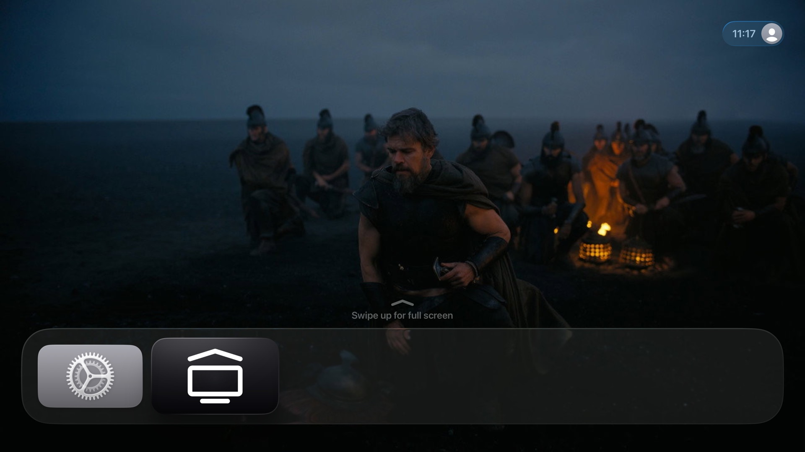
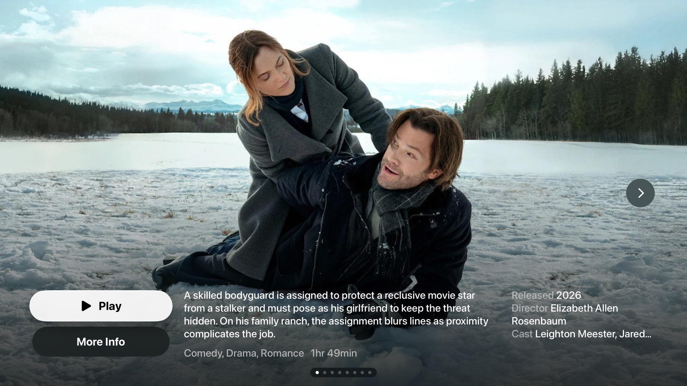
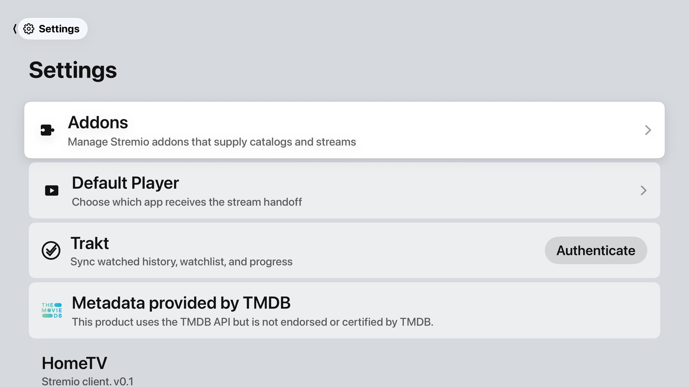
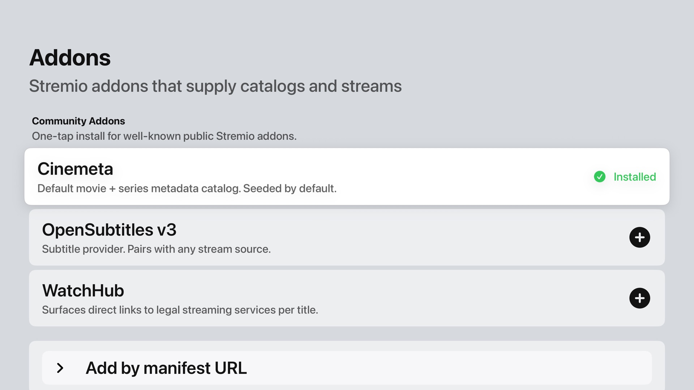
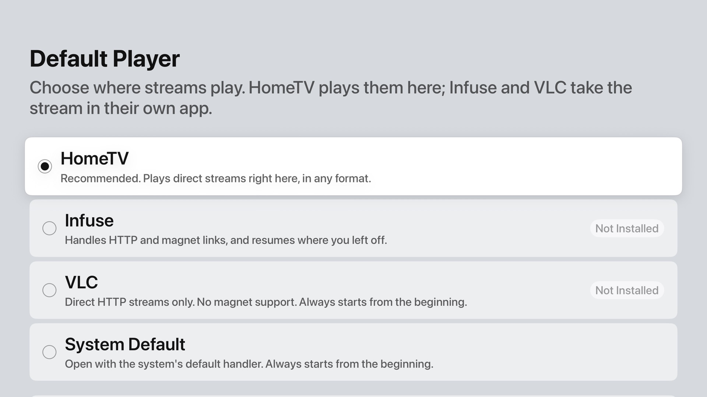

## Top Shelf

The Top Shelf is the large banner at the top of the Apple TV Home Screen. When HomeTV is in the top row of apps and
you highlight its icon, the banner becomes a carousel of popular movies and shows that you can open straight in
HomeTV.

### Put HomeTV in the top row

The Top Shelf only shows for apps in the top row.

1. On the Home Screen, highlight HomeTV.
2. Press and hold the clickpad centre (or the touch surface) until the apps start to jiggle, choosing
   **Edit Home Screen** if a menu appears.
3. Move HomeTV up into the top row, then press the clickpad centre to drop it.

Apple's guide to [rearranging apps on the Home Screen](https://support.apple.com/HT200126) has more detail.

### What the carousel shows

Up to eight titles from Cinemeta's popular movies and popular TV shows, alternating a movie and a show. Titles
without wide artwork are left out, so there can be fewer. Each title fills the banner with its wide artwork, and
the banner moves on to the next one by itself.

Swipe up to see the carousel full screen. The dots at the bottom show which title you're on. Swipe left or right
to move between titles, and press Back to return to the Home Screen.

The carousel is the same for everyone. It doesn't depend on which add-ons you've installed, on your watchlist or
on Trakt. tvOS decides when to refresh it, so it can lag a little behind the popular lists.

If the Apple TV can't reach the catalog, for example while it's offline, the Top Shelf shows the HomeTV banner
instead.

### Title details

In full screen, click a title to see its details: the description, genres and runtime, and, when they're known,
the year it came out, the director and up to three cast members.

### Trailers

With the [Trailerio add-on](/guide/setup-and-addons/#trailers) installed and turned on, each title's trailer starts
playing in the banner a moment after it appears. Swipe up to watch it full screen. Titles Trailerio has no trailer
for, and every title without Trailerio, show still artwork.

### Opening a title

In a title's details, select **Play** or **More Info**. Both open HomeTV on that title's page, in the Watch Now
tab. **Play** doesn't start playing; select **Play** on the title's page for that. If you had something else open
in Watch Now, the title's page replaces it. Press Back to go to Watch Now.

## Settings

Open **Settings** from the sidebar. It has up to four rows, then the app's name and version at the bottom.

| Row | What it's for | Shows |
| --- | --- | --- |
| **Addons** | Install, turn off and remove add-ons | Always |
| **Default Player** | Where streams play, and Skip Intro | Always |
| **Trakt** | Sign in to Trakt, or sign out | Only when the app was built with Trakt keys |
| **Metadata provided by TMDB** | TMDB's credit. It can't be selected | Only when the app was built with a TMDB key |

The Trakt and TMDB keys are added when the app is built, not in Settings. See
[Optional: TMDB and Trakt keys](/guide/setup-and-addons/#optional-tmdb-and-trakt-keys).

Press Back on Settings to open the sidebar, and on any screen opened from Settings to return to it.

### Addons

| Section | What you can do |
| --- | --- |
| **Community Addons** | Install Cinemeta, OpenSubtitles v3 or WatchHub with one click, or install one again to [refresh it](/guide/setup-and-addons/#refresh-an-add-on). |
| **Add by manifest URL** | Enter an add-on's manifest URL and select **Install Typed URL**. |
| **Installed** | Every add-on you've installed, in install order, with a switch to turn it off and a trash button to remove it. |

[Setup and add-ons](/guide/setup-and-addons/) covers finding add-ons, entering URLs and what to do when an install
fails.

### Default Player

| Setting | Choices | Default |
| --- | --- | --- |
| Player | **HomeTV**, **Infuse**, **VLC** or **System Default**. Infuse and VLC can only be chosen when their app is installed. | HomeTV |
| **Skip Intros & Credits** | **On** or **Off**. Select the row to switch. On shows Skip Intro, Skip Recap and Skip Credits in HomeTV's player. | On |

[Which player to choose](/guide/playback/#which-player-to-choose) compares the players, and
[Skip Intro and Skip Credits](/guide/playback/#skip-intro-and-skip-credits) covers the buttons.

### Trakt

Select **Authenticate** to sign in with a code, or **Sign Out** to forget your Trakt account. When signed in, the
row shows your Trakt username. [Trakt and Library](/guide/trakt-and-library/) covers signing in and what syncs.

### Metadata provided by TMDB

TMDB's logo and the statement that HomeTV uses the TMDB API but isn't endorsed or certified by TMDB. TMDB asks apps
that use its data to show this. There's nothing to set.

## FAQ and troubleshooting

### Watch Now rows are empty or missing

An add-on's catalog rows keep their titles even when their posters don't load. Other rows only appear when they
have something in them. Find the case that matches:

- **Watch Now says No addons installed.** HomeTV couldn't install Cinemeta on first launch, or every add-on is
  removed or turned off. Check the Apple TV is online, then install Cinemeta from **Settings → Addons →
  Community Addons**, or turn your add-ons back on under **Installed**.
- **Every row shows its title but no posters.** The Apple TV was probably offline when HomeTV opened, and HomeTV
  doesn't try again on its own. Check its connection in the Apple TV's Settings, then quit HomeTV (press the TV
  button twice and swipe HomeTV up) and open it again.
- **Only one add-on's rows have no posters, or its rows are missing.** Check its switch is on in
  **Settings → Addons**. If it is, [refresh the add-on](/guide/setup-and-addons/#refresh-an-add-on): its stored
  manifest is probably out of date. If that doesn't help, the add-on's server may be down. Try again later.
- **There's no Explore Channels & Apps or In Theaters & At Home row.** Both need a
  [TMDB key](/guide/setup-and-addons/#optional-tmdb-and-trakt-keys).
- **There's no Continue Watching or Recently Watched row.** They fill once you've watched something. Signed in to
  Trakt, they come from your Trakt history and progress. See
  [Where it shows up](/guide/trakt-and-library/#where-it-shows-up).

### Play finds no streams

The stream list says why. Each message has its own fix in
[When there are no streams](/guide/playback/#when-there-are-no-streams). The most common one on a new install is
**No Streaming Add-ons**: HomeTV doesn't come with a stream add-on, so
[install one](/guide/setup-and-addons/#install-a-stream-add-on).

### A stream won't play

| What you see | What to do |
| --- | --- |
| **This stream couldn't be played.** in HomeTV's player | Press Back to return to the stream list and pick another, preferably a different release or a cached debrid stream. If it keeps happening with 4K MKV files, set **Settings → Default Player** to Infuse. |
| A short "being downloaded" clip instead of the title | The stream is a debrid download that isn't cached (orange badge). Pick a cached one (green badge), or try again once the service has the file. See [Debrid streams](/guide/playback/#debrid-streams). |
| **This stream can't play in HomeTV. Choose a direct stream, or switch players in Settings.** | It's a magnet link. Pick another stream, or set **Settings → Default Player** to Infuse. |
| **Infuse is not installed on this Apple TV.** (or VLC) | Install the app from the App Store, or set **Settings → Default Player** to HomeTV. |
| **Failed to hand off to the external player.** | The other app didn't open. Open it once from the Home Screen, then try again, or switch to HomeTV. |
| **This stream has no playable URL.** | The add-on sent a stream without a link. Pick another stream. |
| Infuse shows an error and you can't get back | Press the TV button and open HomeTV again from the Home Screen ([#49](https://github.com/Nziranziza/home-tv/issues/49)). |

### HomeTV stopped opening after 7 days

With a free Apple Account, Apple's signature on the app lasts 7 days. After that HomeTV won't open, or Xcode says
**Could not launch HomeTV**. Rebuild it from the Mac as in
[Keep HomeTV running](/guide/install/#keep-hometv-running). Your add-ons, library and settings stay on the Apple TV.
A paid Apple Developer account signs the app for a year.

### Trailers are missing

- **No trailers anywhere.** Install the [Trailerio add-on](/guide/setup-and-addons/#trailers) and check its switch
  is on in **Settings → Addons**.
- **One title has no trailer.** Trailerio doesn't have one for it. With a
  [TMDB key](/guide/setup-and-addons/#optional-tmdb-and-trakt-keys), the title's page may still list trailers that
  open in YouTube.
- **Trailers play in HomeTV but not on the Top Shelf.** Open HomeTV once after installing Trailerio, so it can pass
  the add-on on to the Top Shelf, then give tvOS time to refresh the banner. If you built HomeTV with your own
  identifiers, check that the App Group is the same in all four files from
  [step 5 of installing](/guide/install/#5-give-the-app-your-own-identifiers).
- **The Top Shelf only shows the HomeTV banner.** It couldn't reach the catalog. Check the Apple TV's connection;
  the carousel comes back the next time tvOS refreshes it.
