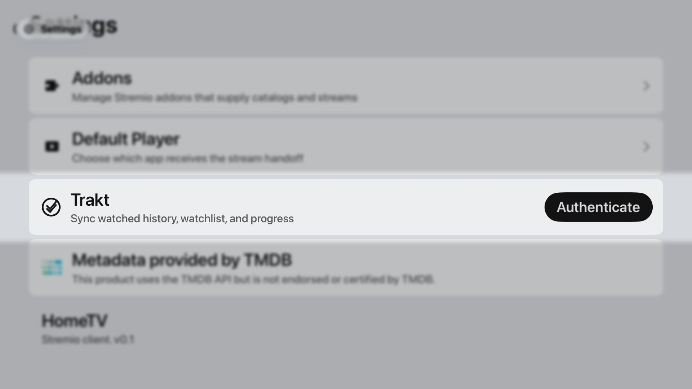
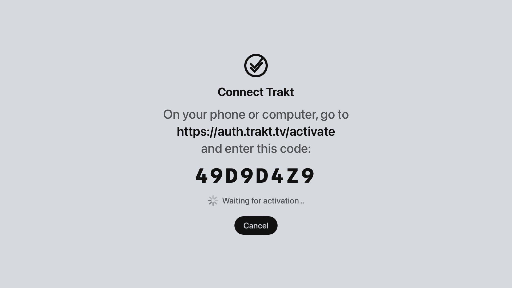
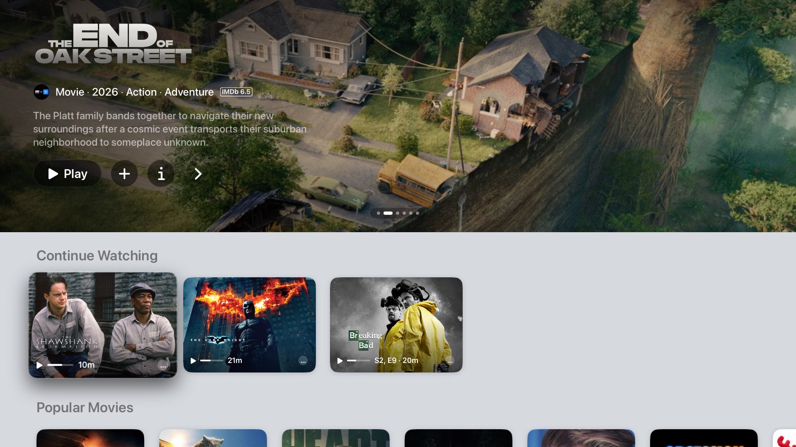
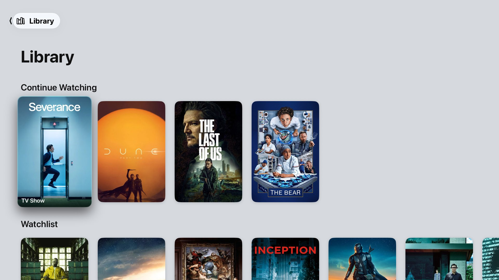

[Trakt](https://trakt.tv) keeps track of what you watch across apps. Sign in to it in HomeTV and your watched
history, watchlist and playback progress are the same here as in your other Trakt apps, such as Infuse on another
device or Trakt's own app on your phone.

Trakt is optional. Without it, HomeTV keeps the same things on the Apple TV, and every screen works the same way.

## Before you start

You need a Trakt account, which is free, and a HomeTV build with Trakt keys. The **Trakt** row only appears in
Settings when the app was built with them. [Optional: TMDB and Trakt keys](/guide/setup-and-addons/#optional-tmdb-and-trakt-keys)
covers adding them.

## Sign in

1. Open **Settings** from the sidebar. The **Trakt** row says **Sync watched history, watchlist, and progress**.
2. Select **Authenticate**. A **Connect Trakt** screen opens with a web address and an eight-character code.
3. On your phone or computer, go to the address on screen,
   [auth.trakt.tv/activate](https://auth.trakt.tv/activate), and sign in to Trakt if it asks.
4. Enter the code and approve HomeTV.

Within a few seconds the screen closes by itself, and the row says **Signed in as** and your Trakt username.
HomeTV then loads your history, watchlist and progress, so Watch Now and the Library tab fill in a moment later.

To stop, select **Cancel** or press Back. You can start again with a new code at any time.

You stay signed in when you quit HomeTV or restart the Apple TV. If you remove HomeTV from **Connected Apps** in
your Trakt settings, syncing stops, but HomeTV can still show you as signed in until it next renews its access to
Trakt, and then signs you out. To reconnect sooner, select **Sign Out**, then **Authenticate**.

### If sign-in doesn't work

When sign-in stops, the screen closes and the Trakt row says why, in red:

| Message | What to do |
| --- | --- |
| The sign-in code expired. Please try again. | Select **Authenticate** for a new code, and enter it within a few minutes. |
| Sign-in didn't complete. Please try again. | The code was turned down or already used. Start again with a new code. |
| Couldn't reach Trakt. Check your connection and try again. | Check the Apple TV's network connection. |
| Trakt rejected the API key. Check the Client ID and Secret in TraktConfig. | The Trakt keys the app was built with are wrong. Check `TRAKT_CLIENT_ID` and `TRAKT_CLIENT_SECRET` in `Secrets.xcconfig` and install the app again. |
| Trakt returned HTTP 500. Please try again. | Trakt had a problem. Try again later. |

## Sign out

Open **Settings** and select **Sign Out** on the Trakt row. There's no confirmation: HomeTV forgets your Trakt
account straight away and goes back to what's kept on the Apple TV. Nothing changes on Trakt.

## What syncs

| | HomeTV reads it from Trakt | HomeTV sends it to Trakt |
| --- | --- | --- |
| Watched movies and episodes | Yes | When you mark something watched or unwatched, and when you finish an episode in Infuse |
| Watchlist | Yes | When you add or remove a title |
| Playback progress | Yes | While you watch in HomeTV's player |
| Watch history | Yes, for Recently Watched | When you finish a movie or episode in HomeTV's player |

Changes you make are sent to Trakt straight away. If Trakt can't be reached, the change is undone: a watched mark
or watchlist checkmark goes back to how it was.

HomeTV picks up changes made in other apps:

- when it starts, and right after you sign in,
- when you come back to it, for example after watching in Infuse, at most every 30 seconds,
- when you open the Library tab,
- for a show's episode checkmarks, when you open the show's page.

## Where it shows up

### Continue Watching

Signed in, [Continue Watching](/guide/watch-now/#continue-watching) on Watch Now and in the Library tab is built
from Trakt:

- **Movies and episodes you stopped partway through**, in HomeTV or any other app that reports to Trakt.
- **The next episode of shows you're watching.** When you finish an episode, its show comes back with the next one
  that has aired. HomeTV checks the ten shows you watched most recently.

Each show appears once, on its latest episode, and the most recent activity comes first. When you've seen every
episode that has aired, the show leaves the row.

Signed out, the row shows titles you've pressed Play on in the last day.

### Recently Watched

Signed in, [Recently Watched](/guide/watch-now/#recently-watched) at the bottom of Watch Now shows up to 20 movies
and episodes from your Trakt history, newest first, one card per episode. Watching something twice still gives it
one card. Anything in Continue Watching is left out, so a movie you've started again leaves Recently Watched until
you finish it. Signed out, it shows the titles that have left Continue Watching.

### Watched marks and Play

The eye on a [title's page](/guide/titles-episodes-cast/), the checkmarks on its episodes and what **Play** plays
all come from Trakt when you're signed in. Mark an episode watched in another app and Play moves on to the next one
here too.

For [Resume](/guide/playback/#saved-position), HomeTV uses whichever was played most recently: its own saved
position or Trakt's.

### Watchlist

The **+** button on Watch Now's hero and on a title's page adds to your Trakt watchlist when you're signed in.
Titles you add in other Trakt apps appear in the Library tab.

## Library tab

Open **Library** from the sidebar. It has two rows:

- **Continue Watching**: the same titles as [on Watch Now](#continue-watching).
- **Watchlist**: everything you've added with **+**. Signed in, movies come first, then shows. Signed out, the
  newest addition comes first.

Select a poster to open the title's page. Unlike on Watch Now, selecting a Continue Watching card here doesn't start
playing.

A row only appears when it has something in it. With nothing in either, the tab says **Your Library is empty**;
select **Browse Watch Now** to go and find something.

## Without Trakt

Everything on this page works without signing in. HomeTV keeps your watchlist, watched marks, resume points,
Continue Watching and Recently Watched on the Apple TV. They aren't shared with other devices, and they're deleted
if you delete the app.

What's on the Apple TV and what's on Trakt are kept apart:

- **Signing in doesn't upload anything.** Your Trakt account replaces what's on the Apple TV for as long as you're
  signed in. Titles you added to the watchlist before signing in don't move to Trakt.
- **Signing out brings back what's on the Apple TV.** That includes resume points and episodes you finished in a
  player while signed in, which HomeTV saves on the Apple TV too.
- **Watchlist changes and watched marks you make while signed in stay on Trakt.** They don't appear after you sign
  out.

## Remote controls

| Where | Select | Back |
| --- | --- | --- |
| Trakt row in Settings | Sign in, or sign out | Open the sidebar |
| Connect Trakt | Cancel sign-in | Cancel sign-in |
| Library row | Open the title's page | Open the sidebar |
| Your Library is empty | Go to Watch Now | Open the sidebar |
