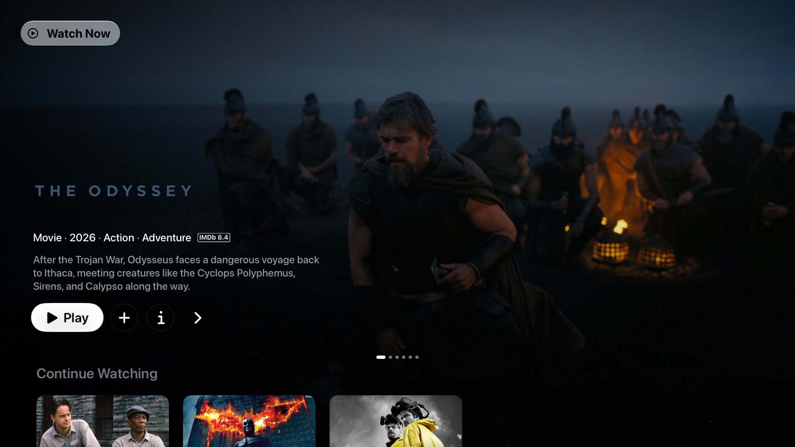
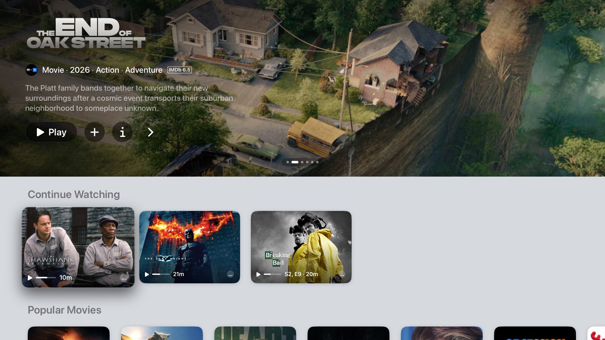
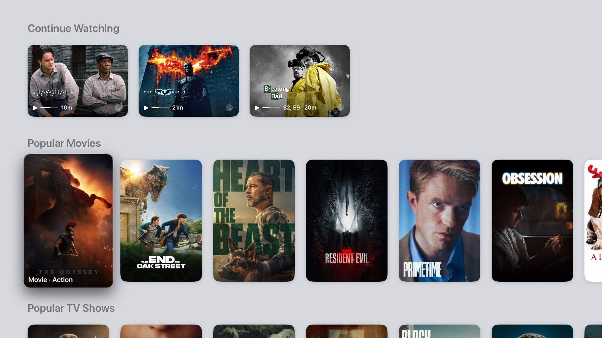
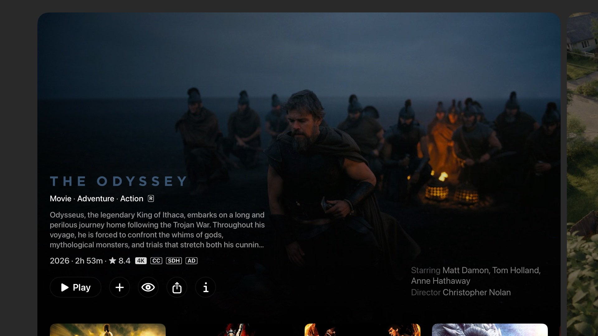
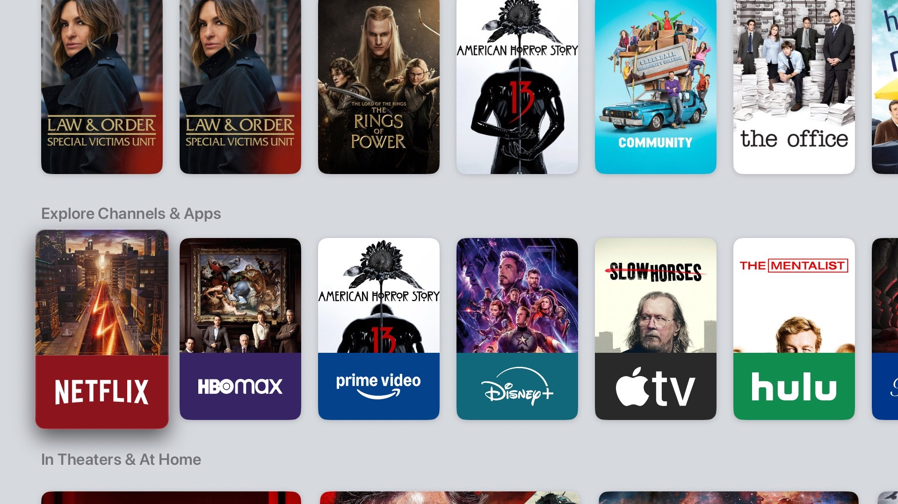
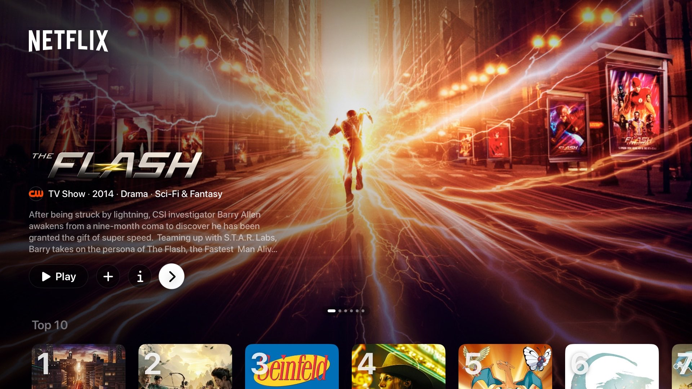
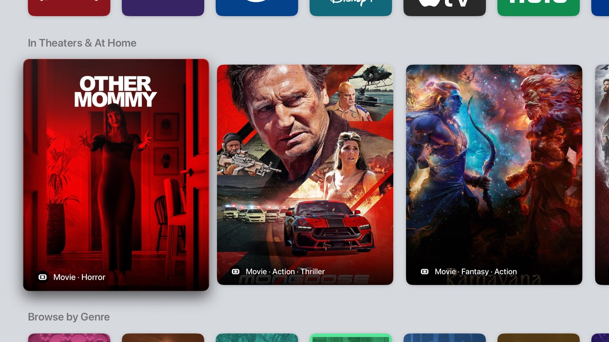
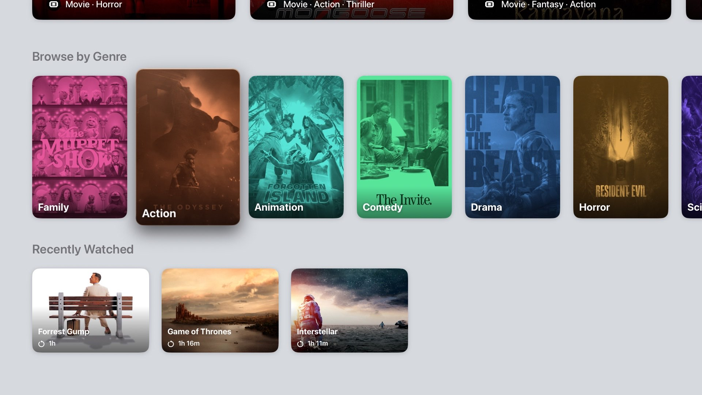
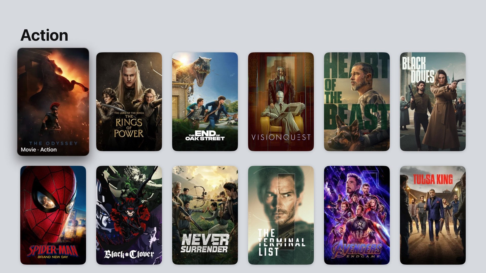
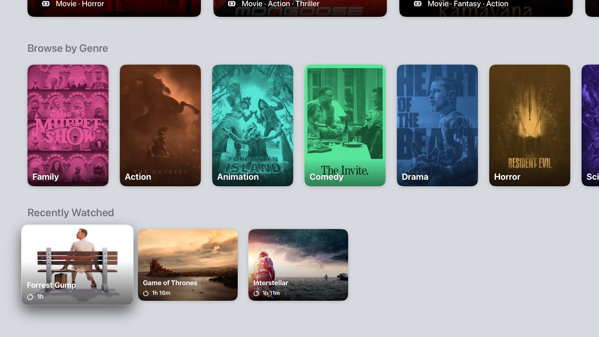

Watch Now is the tab HomeTV opens on. A full-screen hero sits at the top, with rows of titles below it. This page
goes through them from top to bottom.

Press Down and Up to move between rows, and Left and Right to move along a row. Press Left at the start of a row
to open the sidebar, where you can switch to Search, Library or Settings. Press Back (Menu on older remotes) to
leave any screen you open from Watch Now.

Rows only appear when they have something to show, so yours may not have all of them. If Watch Now says
**No addons installed**, see [Setup and add-ons](/guide/setup-and-addons/#first-launch).

## Hero

The hero shows up to six featured titles from the first catalog of your first add-on. Each one has its logo or
name, its type, year, genres and IMDb rating, the streaming service that carries it (when you've added a
[TMDB key](/guide/setup-and-addons/#optional-tmdb-and-trakt-keys)), and a short description. The dots near the
bottom show which title you're on.

The buttons under the description:

- **Play** opens the stream list for the title. For a show, it picks the episode you're up to: the one you were
  watching, or the next one if you finished it. [Picking a stream](/guide/playback/) covers the list.
- **+** adds the title to your Watchlist. It turns into a checkmark; select it again to remove the title.
- **i** opens the title's page.
- **>** shows the next featured title.

### Paging through titles

The titles slide past like a filmstrip. Press Right on **>**, or select it, to move to the next title. Press Left
on **Play** to go back one. On the first title, Left opens the sidebar instead.

The hero also moves on by itself every few seconds. It waits while one of its buttons is focused, so it never
changes under you.

### Trailers

With the [Trailerio add-on](/guide/setup-and-addons/#trailers) installed, each title's trailer starts playing in
the hero a moment after the title appears, with sound. When it ends, the hero moves to the next title. Scroll
down and the trailer pauses; scroll back up and it carries on. Without Trailerio, the hero shows still artwork.

## Continue Watching

Continue Watching holds the movies and shows you've started. Each card shows the title's artwork and logo, a
progress bar, and the time left. A show's card also shows which episode is next, such as **S2, E9 · 20m**.

Select a card and it plays straight away, without opening the title's page:

- **The episode you're up to.** For a show, HomeTV resumes the episode you were watching. If you finished it, it
  plays the next one.
- **The same stream as last time.** HomeTV asks the add-on you last played the title from for the same file. For
  the next episode, it looks for the same release, so you stay on the same quality and source. While it looks,
  the play icon on the card animates.
- **The stream list if that fails.** If the stream is gone, or you've never played the title, the stream list
  opens so you can pick one.

To open the title's page instead, press and hold Select on the card and choose **Go to Show** or
**Go to Movie**.

Signed in to [Trakt](/guide/trakt-and-library/), this row shows your Trakt progress, so it matches your other
apps. Signed out, it shows titles you've pressed Play on in the last day. After a day they move down to
Recently Watched. If HomeTV doesn't know how far you got, for example because you watched in Infuse, the progress
bar and time are only placeholders.

## Catalog rows

Below Continue Watching, every catalog from your add-ons gets its own row, such as **Popular Movies**,
**Popular TV Shows** and **New Movies**. The rows follow the order of your add-ons in Settings, then each add-on's
own order. The focused poster shows the title's type and genre.

### Row preview

Select a poster and it grows into a full-screen preview of the row. The title fills the screen with its backdrop,
and after a moment its logo, details, description, cast and ratings fade in. With Trailerio installed, the trailer
starts playing in the card after a few seconds.

| Press | What happens |
| --- | --- |
| Right / Left | Slide to the next or previous title in the row. |
| Select or Down | Open the title's page. |
| Up | While a trailer plays, watch it full screen. |
| Back | Shrink back into the row. |

The buttons in the preview are for show only. To play the title or add it to your Watchlist, open its page. When
you close the preview, the row scrolls to the title you stopped on and focus lands on its poster.

## Explore Channels & Apps

One card per streaming service: Netflix, HBO Max, Prime Video, Disney+, Apple TV, Hulu, Paramount+, Peacock,
STARZ, AMC+, MGM+ and Crunchyroll. Each card shows the service's logo over artwork from one of its popular titles.
This row needs a [TMDB key](/guide/setup-and-addons/#optional-tmdb-and-trakt-keys).

Select a card to open that service's channel screen.

The channel screen works like Watch Now. At the top, the service's logo sits over a hero of its most popular
titles, with the same **Play**, **+**, **i** and **>** buttons. Below it:

- **Top 10**, the service's ten most popular titles right now.
- Rows such as **Popular TV Shows**, **Popular Movies**, **New Releases**, **Top Rated Movies**, **Comedy**,
  **Drama** and **Documentaries**.

Select a title to open its page. The channel shows what the service carries in the US, according to TMDB. You
don't need a subscription to it: HomeTV still finds streams through your add-ons. Press Back to return to Watch
Now.

## In Theaters & At Home

New movies, as large key art cards. A ticket icon means the movie is in cinemas now. A bag icon means it has just
come out to buy or rent. Select a card to open the movie's page. This row needs a
[TMDB key](/guide/setup-and-addons/#optional-tmdb-and-trakt-keys).

## Browse by Genre

A tile for each genre your add-ons can filter by. Family, Action, Animation, Comedy, Drama, Horror and the other
common genres come first, then the rest in alphabetical order. Each tile is tinted over a poster from that genre.

Select a tile to open the genre screen, a grid of that genre's titles from your add-ons.

Move around the grid and select a poster to open its page. Press Back to return to Watch Now.

## Recently Watched

The last row holds what you've finished, newest first. Signed in to Trakt, it's your Trakt history, one card per
episode with the episode's still and title. Signed out, it shows the titles that have left Continue Watching.

Each card shows a replay icon and the runtime. Select a card to open the title's page, where you can play it
again.

## Remote controls

| Where | Select | Left / Right | Back |
| --- | --- | --- | --- |
| Hero | Run the focused button | Page to the previous or next title | Open the sidebar |
| Continue Watching | Play from where you left off | Move along the row | Open the sidebar |
| Catalog row | Open the row preview | Move along the row | Open the sidebar |
| Row preview | Open the title's page | Page through the row | Close the preview |
| Explore Channels & Apps | Open the channel screen | Move along the row | Open the sidebar |
| In Theaters & At Home | Open the movie's page | Move along the row | Open the sidebar |
| Browse by Genre | Open the genre screen | Move along the row | Open the sidebar |
| Recently Watched | Open the title's page | Move along the row | Open the sidebar |

Press and hold Select on a Continue Watching card to go to its page instead of playing it.
