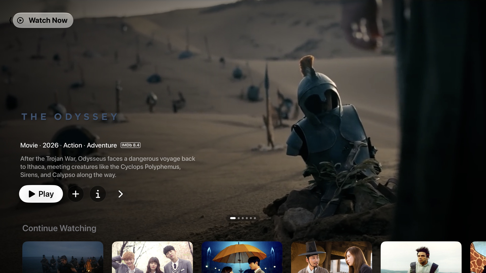

HomeTV is an Apple TV app that looks and feels like Apple's TV app. It browses catalogs from Stremio-compatible
add-ons, fills in artwork, cast and trailers from TMDB, and plays streams in its own player or hands them to Infuse
or VLC. Sign in to Trakt and your progress, watched history and watchlist sync with your other apps.

## Features

- **[Watch Now](/guide/watch-now/).** A full-screen hero carousel with trailers, then rows for Continue Watching,
  each add-on catalog, In Theaters & At Home, streaming channels such as Netflix and HBO Max, genres and Recently
  Watched. Open a row to page through its titles with their trailers.
- **[Search](/guide/search/).** Searches every add-on and cast at once, with Top Results, a section per type and
  suggestions.
- **[Title detail](/guide/titles-episodes-cast/).** Movie and show pages with episodes by season, trailers, cast &
  crew, related titles and details, plus episode and cast pages.
- **[Playback](/guide/playback/).** A stream picker that gathers streams from all your add-ons and remembers your
  choice. The built-in player has Apple-style controls, subtitles, audio options, Skip Intro and Up Next. Infuse and
  VLC are optional.
- **[Trakt](/guide/trakt-and-library/).** Sign in to sync playback progress, watched state, your watchlist and Up
  Next.
- **[Library](/guide/trakt-and-library/).** Continue Watching and your Watchlist, stored on the Apple TV or
  in Trakt when you're signed in.
- **[Top Shelf](/guide/top-shelf-settings-faq/).** A carousel with trailers on the Apple TV Home Screen that opens
  straight into a title.

## Current limits

- **Sideload only.** HomeTV isn't on the App Store. You [build and install it](/guide/install/) from Xcode. With a
  free Apple Developer account the app expires after 7 days and has to be installed again.
- **No CloudStream.** CloudStream plugins are written for Android and don't run on Apple TV. HomeTV uses Stremio
  add-ons only.
- **The built-in player is still being built** ([#107](https://github.com/Nziranziza/home-tv/issues/107)).
  Known gaps:
  - No Picture in Picture yet ([#102](https://github.com/Nziranziza/home-tv/issues/102)).
  - MKV files don't get Dolby Vision or Dolby Atmos, and Dolby Vision profile 5 may show wrong colours
    ([#105](https://github.com/Nziranziza/home-tv/issues/105)). MP4 and HLS streams get both.
  - Magnet links don't play in the built-in player. Pick Infuse in Settings → Default Player to play them.
